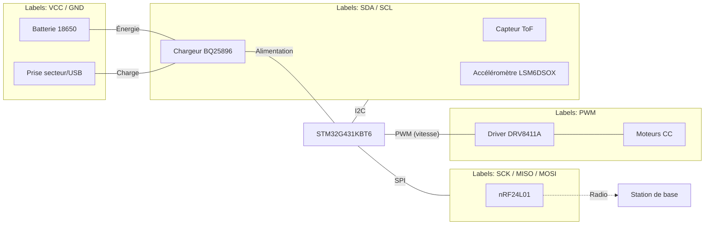

# PC_BOT — Robot mobile autonome avec télémétrie sans fil

> Projet de 1re année (ENSEA) — Robot mobile conçu pour transmettre sa position, sa vitesse, son accélération et les distances aux obstacles à une station de base par liaison radio.

*English version: [README.md](./README.md)*

---

## Table des matières

- [Description du projet](#description-du-projet)
- [Avancement du projet](#avancement-du-projet)
- [Cahier des charges](#cahier-des-charges)
- [Architecture](#architecture)
- [Composants](#composants)
- [Schématique (KiCad)](#schématique-kicad)
- [BOM](#bom)
- [Modèle 3D](#modèle-3d)
- [Bus de communication](#bus-de-communication)
- [Tests unitaires de certains capteurs](#tests-unitaires-de-certains-capteurs)
- [Conclusion](#conclusion)
- [API utilisées (dépôts GitHub)](#api-utilisées-dépôts-github)
- [Mise en route du projet](#mise-en-route-du-projet)
- [Workflow Git](#workflow-git)
- [Ressources](#ressources)

---

## Description du projet

PC_BOT est un robot mobile à roues embarquant :

- Un **microcontrôleur STM32G431KBT6** comme unité centrale de traitement
- Un **capteur ToF** pour mesurer les distances aux obstacles
- Un **accéléromètre/gyroscope LSM6DSOX** pour connaître l'orientation, la vitesse et l'accélération
- Un **module radio nRF24L01+** pour transmettre les données en temps réel à une station de base
- Un système de **gestion de batterie 18650** avec chargeur intégré (BQ25896)

L'objectif à terme est que PC_BOT puisse cartographier une pièce. Les robots se placent sur le périmètre de la pièce, puis se déplacent de manière autonome et communiquent entre eux grâce à un module nRF pour connaître leurs emplacements respectifs. Ces données devront être enregistrées dans une base de données et servir à construire une représentation de la pièce. Voir l'[avancement du projet](#avancement-du-projet) pour ce qui est réalisé à ce jour.

---

## Avancement du projet

| Élément | État |
|---|---|
| Schématique KiCad, PCB et BOM | Réalisé |
| Modèle 3D (Onshape) | Réalisé |
| Test unitaire de la liaison radio nRF24L01+ entre deux cartes STM32 | Réalisé |
| Test unitaire du capteur ToF | Réalisé |
| Communication entre les robots (réseau nRF) | Pas encore implémentée |
| Carte 2D de la pièce construite à partir des données ToF et IMU | Pas encore implémentée |
| Enregistrement des données dans une base de données et représentation de la pièce | Pas encore implémenté |

---

## Cahier des charges

| Fonction | Description |
|---|---|
| Mobilité | Le robot doit rouler de façon autonome |
| Perception | Détecter les obstacles et mesurer les distances (capteur ToF) |
| Localisation | Connaître sa vitesse, son accélération et sa position (IMU) |
| Énergie | Batterie rechargeable 18650 via prise secteur/USB |
| Communication | Transmission continue vers la station de base (nRF24L01+) |
| Données transmises | Angle d'inclinaison, vitesse, accélération, position, distances aux obstacles |

---

## Architecture



---

## Composants

L'architecture matérielle choisie est dimensionnée pour permettre à terme à PC_BOT de **cartographier son environnement en temps réel** (cette cartographie n'est pas encore implémentée, voir l'[avancement du projet](#avancement-du-projet)) :

- Le **capteur ToF (VL53L0X/L1X)** mesure avec précision les distances aux obstacles situés devant le robot, tandis que l'**accéléromètre/gyroscope (LSM6DSOX)** fournit l'odométrie (position et orientation du robot dans l'espace). Ces données transitent rapidement sur le bus I²C vers le STM32.
- Grâce à sa mémoire et à sa vitesse de calcul, le microcontrôleur est destiné à fusionner ces coordonnées pour dessiner une carte 2D de l'espace parcouru.
- Cette carte doit être transmise en temps réel à une station de base ou à une interface graphique externe via le **module radio nRF24L01+**, qui doit aussi permettre aux PC_BOT de communiquer entre eux. Le protocole SPI est ici indispensable pour assurer le débit nécessaire à l'envoi continu de la matrice de la carte.

### Microcontrôleur

| Composant | Référence | Rôle |
|---|---|---|
| MCU | STM32G431KBT6 | Unité centrale |

### Communication et capteurs

| Composant | Référence KiCad | Lien |
|---|---|---|
| Module radio | nRF24L01+ — `Conn_02x04_Odd_Even` | [Tutoriel nRF24L01](https://passionelectronique.fr/tutorial-nrf24l01/) |
| Capteur ToF | VL53L0X / VL53L1X — `J1 TOF` | — |
| Accéléromètre | LSM6DSOX — `Sensor_Motion:LSM6DSOX` | [SnapEDA](https://www.snapeda.com/parts/LSM6DSOX/STMicroelectronics/view-part/) · [Datasheet](https://www.st.com/en/mems-and-sensors/lsm6dsox.html) |

### Motorisation

| Composant | Référence KiCad | Lien |
|---|---|---|
| Driver moteur | DRV8411A — `Interface_Expansion:DRV8411APWPR` | [SnapEDA](https://www.snapeda.com/parts/DRV8411APWPR/Texas%20Instruments/view-part/) · [Datasheet](https://www.ti.com/lit/ds/symlink/drv8411a.pdf) |
| Moteurs CC | Motoréducteur Maqueen V5 | [Gotronic](https://www.gotronic.fr/art-motoreducteur-maqueen-v5-48529.htm) |
| Connecteurs moteurs | `Screw_Terminal_01x02` (×2) | — |

### Gestion de l'énergie

| Composant | Référence KiCad | Lien |
|---|---|---|
| Chargeur de batterie | BQ25896 — `Power_Management:BQ25896` | [SnapEDA](https://www.snapeda.com/parts/BQ25896/Texas%20Instruments/view-part/) · [Datasheet](https://www.ti.com/lit/ds/symlink/bq25896.pdf) |
| Régulateur 3,3 V | AP2112K-3.3 (U5) | — |
| Connecteur USB-C | `USB_C_Receptacle_USB2.0_16P` (J6) | — |
| Batterie | Samsung INR18650-35E (3400 mAh) | [NKON](https://www.nkon.nl/fr/samsung-inr18650-35e-3400mah-8a.html) |
| Inductance | 1 µH — `Inductor_SMD:L_6.3x6.3mm` (L1) | Confirmée par la datasheet du BQ25896 |
| Connecteur batterie | `Connector:Conn_01x02` (J7) | — |

### Composants passifs et interface

| Composant | Valeur / référence KiCad | Remarque |
|---|---|---|
| Résistances de pull-up I2C | 4,7 kΩ (R1, R2) | Entre SDA/SCL et +3,3 V |
| Bouton d'alimentation | `Switch:SW_Push` (SW1) | Interrupteur du STM32 |
| Bouton QON du chargeur | `Switch:SW_Push` (SW3) | Mise en marche du BQ25896 |
| Connecteur ST-LINK | `Conn_ST_STDC14` (J3) | VCC, SWDIO, SWCLK, NRST, GND |
| LED | D1, D2 avec R10, R11 = 2,2 kΩ | Signalisation de l'état du chargeur |

---

## Schématique (KiCad)

Les fichiers KiCad sont disponibles dans le dossier [/Kicad10](./Kicad10) du dépôt.

---

## BOM

À retrouver ici : [BOM](/Kicad10/bom/ibom.html)

---

## Modèle 3D

[Lien Onshape](https://cad.onshape.com/documents/e505b045361e9674a6c78442/w/5afe70fb4d167ecf5afd27e4/e/144ee00e31075047748e348d?renderMode=0&uiState=69dce7b2d3075cd451ff5b6a)

---

## Bus de communication

### Bus I2C — `SDA / SCL`

Les capteurs ci-dessous communiquent via le bus I2C. Ce protocole de communication série synchrone semi-duplex permet de faire communiquer plusieurs composants électroniques sur de courtes distances avec un minimum de fils, ce qui est idéal pour nos PC_BOT.

Périphériques connectés :

- Capteur ToF (VL53L0X/VL53L1X)
- Accéléromètre LSM6DSOX
- Chargeur BQ25896

> Résistances de pull-up nécessaires : **4,7 kΩ** vers +3,3 V (R1, R2).

Ressources :

- [Introduction au bus I2C — Yoctopuce](https://www.yoctopuce.com/FR/article/petite-introduction-au-bus-i2c)
- [Vidéo explicative sur l'I2C](https://youtu.be/15XY4LoQyjc)

### Bus SPI — `SCK / MISO / MOSI`

Le bus SPI est l'autre grand standard de communication série synchrone. Contrairement à l'I²C, il est conçu pour la vitesse et fonctionne en full-duplex. Cette technologie permet à nos modules radio de communiquer simultanément, mais elle nécessite un montage plus complexe et beaucoup plus de fils.

Périphériques connectés :

- Module radio nRF24L01+

Ressources :

- [Introduction au bus SPI](https://lycrouv-sn.fr/rsc/TdTp/Td/ciel2/Datalink/res/bus_spi.pdf)
- [Vidéo explicative sur le SPI](https://youtu.be/2hnIKzI6yYE)

---

## Tests unitaires de certains capteurs

### Test unitaire du module nRF

**Outils** : 2 cartes STM32, 2 modules nRF, PuTTY, STM32CubeIDE

https://github.com/user-attachments/assets/09dd88af-9229-46c6-a460-54290523ae45

https://github.com/user-attachments/assets/6af458ef-1121-4c9b-9ec6-79dbbe4212db

### Test unitaire du capteur ToF

**Outils** : 1 capteur ToF, 1 carte STM32, STM32CubeIDE (PuTTY facultatif)

Le capteur peut détecter des obstacles situés d'environ 3 cm à un peu moins d'un mètre. Sa portée varie selon la luminosité ambiante et elle est beaucoup plus grande dans l'obscurité.

---

## Conclusion

En somme, ce projet était vraiment intéressant et nous a permis de développer et de mettre en application nos compétences en électronique, en informatique et en gestion de projet. La conception du PCB est la partie qui nous a pris le plus de temps, mais elle nous a permis de concevoir en autonomie un PCB répondant à un besoin réel, selon un cahier des charges donné, et de souder en essayant de rendre le montage le plus écologique possible afin de tenir compte de l'impact environnemental.

Nous retenons également que la soudure des composants et le routage sont des étapes très importantes pour le bon fonctionnement du PCB : une fausse manipulation entraîne très vite un court-circuit qui endommage la carte et, au pire, tous les capteurs qui y sont montés.

---

## API utilisées (dépôts GitHub)

> [!NOTE]
>
> Des essais des capteurs suivants ont d'abord été réalisés sur un **STM32L021K4Tx**.

### Annexes

| Composant | API / Driver | Dépôt |
|---|---|---|
| Capteur ToF VL53L0X | Driver HAL STM32 | [hoangducquy93/VL530X](https://github.com/hoangducquy93/VL530X) |
| Accéléromètre LSM6DSOX | Platform Independent Driver (PID) | [STMicroelectronics/lsm6dsox-pid](https://github.com/STMicroelectronics/lsm6dsox-pid) |
| Exemples LSM6DSOX | STMems Standard C drivers | [STMicroelectronics/STMems_Standard_C_drivers](https://github.com/STMicroelectronics/STMems_Standard_C_drivers) |
| Module radio nRF24L01+ | Driver HAL STM32 (communautaire) | [controllerstech/nRF24L01](https://github.com/controllerstech/nRF24L01) |
| HAL STM32G4 | STM32CubeG4 HAL | [STMicroelectronics/stm32g4xx-hal-driver](https://github.com/STMicroelectronics/stm32g4xx-hal-driver) |
| HAL STM32L0 | STM32CubeL0 HAL | [STMicroelectronics/stm32l0xx-hal-driver](https://github.com/STMicroelectronics/stm32l0xx-hal-driver) |

---

## Mise en route du projet

### Prérequis

- [KiCad](https://www.kicad.org/) (conception du schéma et du PCB)
- [STM32CubeIDE](https://www.st.com/en/development-tools/stm32cubeide.html) (développement du firmware)
- ST-LINK V2 (programmation et débogage du STM32)
- Git + clé SSH configurée sur GitHub

### Cloner le projet

```bash
git clone git@github.com:rahim974/2526_projet1a_pcbot1.git
cd 2526_projet1a_pcbot1
```

---

## Workflow Git

```bash
# Récupérer la dernière version
git pull

# Vérifier l'état de vos modifications
git status

# Ajouter et pousser vos modifications
git add .
git commit -m "feat: description de la modification"
git push
```

---

## Ressources

| Sujet | Lien |
|---|---|
| Datasheet LSM6DSOX | [st.com](https://www.st.com/en/mems-and-sensors/lsm6dsox.html) |
| Datasheet DRV8411A | [ti.com](https://www.ti.com/lit/ds/symlink/drv8411a.pdf) |
| Datasheet BQ25896 | [ti.com](https://www.ti.com/lit/ds/symlink/bq25896.pdf) |
| Tutoriel nRF24L01 | [passionelectronique.fr](https://passionelectronique.fr/tutorial-nrf24l01/) |
| Batterie 18650 Samsung | [nkon.nl](https://www.nkon.nl/fr/samsung-inr18650-35e-3400mah-8a.html) |
| Moteur CC Maqueen V5 | [gotronic.fr](https://www.gotronic.fr/art-motoreducteur-maqueen-v5-48529.htm) |
