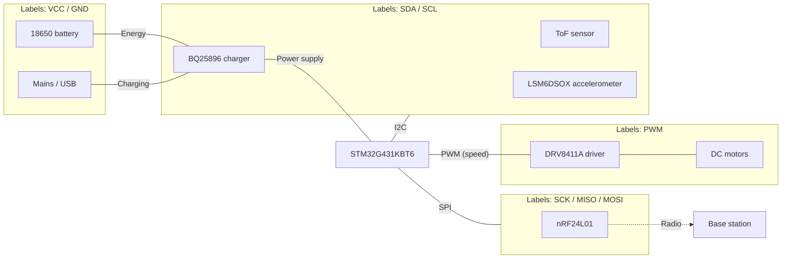

# PC_BOT — Autonomous Mobile Robot with Wireless Telemetry

> Year-1 project (ENSEA) — A mobile robot designed to transmit its position, speed, acceleration and distances to obstacles to a base station over a radio link.

*Version française : [README.fr.md](./README.fr.md)*

---

## Table of Contents

- [Project Description](#project-description)
- [Project Status](#project-status)
- [Requirements](#requirements)
- [Architecture](#architecture)
- [Components](#components)
- [Schematic (KiCad)](#schematic-kicad)
- [BOM](#bom)
- [3D Model](#3d-model)
- [Communication Buses](#communication-buses)
- [Unit Tests of Selected Sensors](#unit-tests-of-selected-sensors)
- [Conclusion](#conclusion)
- [APIs Used (GitHub Repositories)](#apis-used-github-repositories)
- [Getting Started](#getting-started)
- [Git Workflow](#git-workflow)
- [Resources](#resources)

---

## Project Description

PC_BOT is a wheeled mobile robot that embeds:

- An **STM32G431KBT6 MCU** as the central processing unit
- A **ToF sensor** to measure distances to obstacles
- A **LSM6DSOX accelerometer/gyroscope** to obtain orientation, speed and acceleration
- A **nRF24L01+ radio module** to transmit data in real time to a base station
- An **18650 battery management system** with an integrated charger (BQ25896)

The long-term goal of PC_BOT is to map a room. The robots position themselves around the perimeter of the room, then move autonomously and communicate with each other through an nRF module to know their respective positions. This data is meant to be stored in a database and used to build a representation of the room. See [Project Status](#project-status) for what is implemented so far.

---

## Project Status

| Item | Status |
|---|---|
| KiCad schematic, PCB and BOM | Done |
| 3D model (Onshape) | Done |
| Unit test of the nRF24L01+ radio link between two STM32 boards | Done |
| Unit test of the ToF sensor | Done |
| Communication between robots (nRF network) | Not yet implemented |
| 2D map of the room built from ToF and IMU data | Not yet implemented |
| Storage of the data in a database and representation of the room | Not yet implemented |

---

## Requirements

| Function | Description |
|---|---|
| Mobility | The robot must drive autonomously |
| Perception | Detect obstacles and measure distances (ToF sensor) |
| Localization | Know its speed, acceleration and position (IMU) |
| Energy | Rechargeable 18650 battery, charged through mains/USB |
| Communication | Continuous transmission to the base station (nRF24L01+) |
| Transmitted data | Tilt angle, speed, acceleration, position, distances to obstacles |

---

## Architecture



---

## Components

The chosen hardware architecture is sized to let PC_BOT eventually **map its environment in real time** (this mapping is not implemented yet, see [Project Status](#project-status)):

- The **ToF sensor (VL53L0X/1X)** measures precise distances to obstacles in front of the robot, while the **accelerometer/gyroscope (LSM6DSOX)** provides odometry (position and orientation of the robot in space). This data travels quickly over the I²C bus to the STM32.
- Thanks to its memory and computing speed, the microcontroller is intended to fuse these coordinates to draw a 2D map of the space covered.
- This map is meant to be transmitted in real time to a base station or an external graphical interface through the **nRF24L01+ radio module**, which is also intended to let the PC_BOTs communicate with each other. The SPI protocol is essential here to provide the throughput needed for the continuous transmission of the map matrix.

### Microcontroller

| Component | Reference | Role |
|---|---|---|
| MCU | STM32G431KBT6 | Central processing unit |

### Communication & Sensors

| Component | KiCad reference | Link |
|---|---|---|
| Radio module | nRF24L01+ — `Conn_02x04_Odd_Even` | [nRF24L01 tutorial (French)](https://passionelectronique.fr/tutorial-nrf24l01/) |
| ToF sensor | VL53L0X / VL53L1X — `J1 TOF` | — |
| Accelerometer | LSM6DSOX — `Sensor_Motion:LSM6DSOX` | [SnapEDA](https://www.snapeda.com/parts/LSM6DSOX/STMicroelectronics/view-part/) · [Datasheet](https://www.st.com/en/mems-and-sensors/lsm6dsox.html) |

### Motor Drive

| Component | KiCad reference | Link |
|---|---|---|
| Motor driver | DRV8411A — `Interface_Expansion:DRV8411APWPR` | [SnapEDA](https://www.snapeda.com/parts/DRV8411APWPR/Texas%20Instruments/view-part/) · [Datasheet](https://www.ti.com/lit/ds/symlink/drv8411a.pdf) |
| DC motors | Maqueen V5 gear motor | [Gotronic](https://www.gotronic.fr/art-motoreducteur-maqueen-v5-48529.htm) |
| Motor connectors | `Screw_Terminal_01x02` (×2) | — |

### Power Management

| Component | KiCad reference | Link |
|---|---|---|
| Battery charger | BQ25896 — `Power_Management:BQ25896` | [SnapEDA](https://www.snapeda.com/parts/BQ25896/Texas%20Instruments/view-part/) · [Datasheet](https://www.ti.com/lit/ds/symlink/bq25896.pdf) |
| 3.3 V regulator | AP2112K-3.3 (U5) | — |
| USB-C connector | `USB_C_Receptacle_USB2.0_16P` (J6) | — |
| Battery | Samsung INR18650-35E (3400 mAh) | [NKON](https://www.nkon.nl/fr/samsung-inr18650-35e-3400mah-8a.html) |
| Inductor | 1 µH — `Inductor_SMD:L_6.3x6.3mm` (L1) | Confirmed in the BQ25896 datasheet |
| Battery connector | `Connector:Conn_01x02` (J7) | — |

### Passive Components & Interface

| Component | Value / KiCad reference | Note |
|---|---|---|
| I2C pull-up resistors | 4.7 kΩ (R1, R2) | Between SDA/SCL and +3.3 V |
| Power button | `Switch:SW_Push` (SW1) | STM32 power switch |
| Charger QON button | `Switch:SW_Push` (SW3) | Turns on the BQ25896 |
| ST-LINK connector | `Conn_ST_STDC14` (J3) | VCC, SWDIO, SWCLK, NRST, GND |
| LEDs | D1, D2 with R10, R11 = 2.2 kΩ | Charger status indication |

---

## Schematic (KiCad)

The KiCad files are available in the [/Kicad10](./Kicad10) folder of the repository.

---

## BOM

Available here: [BOM](/Kicad10/bom/ibom.html)

---

## 3D Model

[Onshape link](https://cad.onshape.com/documents/e505b045361e9674a6c78442/w/5afe70fb4d167ecf5afd27e4/e/144ee00e31075047748e348d?renderMode=0&uiState=69dce7b2d3075cd451ff5b6a)

---

## Communication Buses

### I2C Bus — `SDA / SCL`

The sensors below communicate over the I2C bus. This synchronous, half-duplex serial protocol lets several electronic components communicate over short distances with a minimum of wires, which is ideal for our PC_BOTs.

Connected peripherals:

- ToF sensor (VL53L0X/VL53L1X)
- LSM6DSOX accelerometer
- BQ25896 charger

> Pull-up resistors are required: **4.7 kΩ** to +3.3 V (R1, R2).

Resources:

- [Introduction to the I2C bus — Yoctopuce (French)](https://www.yoctopuce.com/FR/article/petite-introduction-au-bus-i2c)
- [I2C explainer video](https://youtu.be/15XY4LoQyjc)

### SPI Bus — `SCK / MISO / MOSI`

SPI is the other major standard for synchronous serial communication. Unlike I²C, it is built for speed and works in full duplex. This lets our radio modules communicate simultaneously, but it requires a more complex setup and many more wires.

Connected peripherals:

- nRF24L01+ radio module

Resources:

- [Introduction to the SPI bus (French)](https://lycrouv-sn.fr/rsc/TdTp/Td/ciel2/Datalink/res/bus_spi.pdf)
- [SPI explainer video](https://youtu.be/2hnIKzI6yYE)

---

## Unit Tests of Selected Sensors

### Unit test of the nRF module

**Tools**: 2 STM32 boards, 2 nRF modules, PuTTY, STM32CubeIDE

https://github.com/user-attachments/assets/09dd88af-9229-46c6-a460-54290523ae45

https://github.com/user-attachments/assets/6af458ef-1121-4c9b-9ec6-79dbbe4212db

### Unit test of the ToF sensor

**Tools**: 1 ToF sensor, 1 STM32 board, STM32CubeIDE (PuTTY optional)

The sensor can detect obstacles located from about 3 cm to just under one meter. Its range varies with ambient light and is much greater in the dark.

---

## Conclusion

Overall, this project was really interesting and allowed us to develop and apply our skills in electronics, computer science and project management. PCB design took us the most time, but it allowed us to independently design a PCB for a real need, following a given specification, and to do the soldering while trying to be as eco-friendly as possible to account for environmental impact.

We also learned that soldering the components and routing the board are very important steps for the PCB to work properly: a single wrong move can quickly cause a short circuit that damages the board and, in the worst case, all the sensors mounted on it.

---

## APIs Used (GitHub Repositories)

> [!NOTE]
>
> The following sensors were first tested on an **STM32L021K4Tx**.

### Appendix

| Component | API / Driver | Repository |
|---|---|---|
| ToF sensor VL53L0X | STM32 HAL driver | [hoangducquy93/VL530X](https://github.com/hoangducquy93/VL530X) |
| LSM6DSOX accelerometer | Platform Independent Driver (PID) | [STMicroelectronics/lsm6dsox-pid](https://github.com/STMicroelectronics/lsm6dsox-pid) |
| LSM6DSOX examples | STMems Standard C drivers | [STMicroelectronics/STMems_Standard_C_drivers](https://github.com/STMicroelectronics/STMems_Standard_C_drivers) |
| nRF24L01+ radio module | STM32 HAL driver (community) | [controllerstech/nRF24L01](https://github.com/controllerstech/nRF24L01) |
| STM32G4 HAL | STM32CubeG4 HAL | [STMicroelectronics/stm32g4xx-hal-driver](https://github.com/STMicroelectronics/stm32g4xx-hal-driver) |
| STM32L0 HAL | STM32CubeL0 HAL | [STMicroelectronics/stm32l0xx-hal-driver](https://github.com/STMicroelectronics/stm32l0xx-hal-driver) |

---

## Getting Started

### Prerequisites

- [KiCad](https://www.kicad.org/) (schematic and PCB design)
- [STM32CubeIDE](https://www.st.com/en/development-tools/stm32cubeide.html) (firmware development)
- ST-LINK V2 (STM32 programming and debugging)
- Git + an SSH key configured on GitHub

### Clone the Project

```bash
git clone git@github.com:rahim974/2526_projet1a_pcbot1.git
cd 2526_projet1a_pcbot1
```

---

## Git Workflow

```bash
# Get the latest version
git pull

# Check the state of your changes
git status

# Add and push your changes
git add .
git commit -m "feat: description of the change"
git push
```

---

## Resources

| Topic | Link |
|---|---|
| LSM6DSOX datasheet | [st.com](https://www.st.com/en/mems-and-sensors/lsm6dsox.html) |
| DRV8411A datasheet | [ti.com](https://www.ti.com/lit/ds/symlink/drv8411a.pdf) |
| BQ25896 datasheet | [ti.com](https://www.ti.com/lit/ds/symlink/bq25896.pdf) |
| nRF24L01 tutorial (French) | [passionelectronique.fr](https://passionelectronique.fr/tutorial-nrf24l01/) |
| Samsung 18650 battery | [nkon.nl](https://www.nkon.nl/fr/samsung-inr18650-35e-3400mah-8a.html) |
| Maqueen V5 DC motor | [gotronic.fr](https://www.gotronic.fr/art-motoreducteur-maqueen-v5-48529.htm) |
