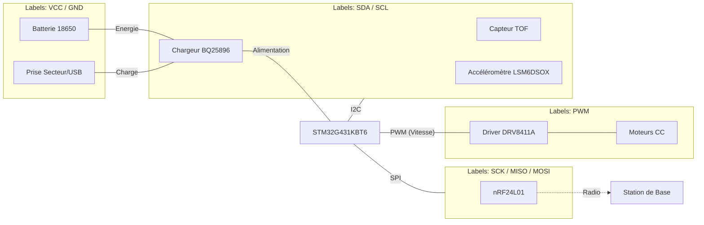

# PC_BOT — Robot mobile autonome avec télémétrie sans fil

> Projet 1A — Robot mobile capable de transmettre en continu sa position, vitesse, accélération et les distances aux obstacles à une station de base via liaison radio.

---

## Table des matières

- [Description du projet](#description-du-projet)
- [Cahier des charges](#cahier-des-charges)
- [Architecture matérielle](#architecture-matérielle)
- [Composants](#composants)
- [Schéma électronique (KiCad)](#schéma-électronique-kicad)
- [Buses de communication](#buses-de-communication)
- [Mise en route du projet](#mise-en-route-du-projet)
- [Workflow Git](#workflow-git)
- [Ressources](#ressources)

---

## Description du projet

PC_BOT est un robot mobile sur roues embarquant :

- Un **MCU STM32G431KBT6** comme unité centrale de traitement
- Un **capteur ToF** pour mesurer les distances aux obstacles
- Un **accéléromètre/gyroscope LSM6DSOX** pour connaître l'orientation, la vitesse et l'accélération
- Un **module radio nRF24L01+** pour transmettre les données en temps réel à une station de base
- Un système de **gestion de batterie 18650** avec chargeur intégré (BQ25896)

---

## Cahier des charges

| Fonction | Description |
|---|---|
| Mobilité | Le robot doit rouler de façon autonome |
| Perception | Détecter les obstacles et mesurer les distances (capteur ToF) |
| Localisation | Connaître sa vitesse, accélération et position (IMU) |
| Énergie | Batterie rechargeable 18650 via prise secteur/USB |
| Communication | Transmission continue vers la station de base (nRF24L01+) |
| Données transmises | Angle d'inclinaison, vitesse, accélération, position, distances obstacles |

---

## Architecture



---

## Composants

### Microcontrôleur
| Composant | Référence | Rôle |
|---|---|---|
| MCU | STM32G431KBT6 | Unité centrale |

### Communication & Capteurs
| Composant | Référence KiCad | Lien |
|---|---|---|
| Module radio | nRF24L01+ — `Conn_02x04_Odd_Even` | [Tutorial nRF24L01](https://passionelectronique.fr/tutorial-nrf24l01/) |
| Capteur ToF | VL53L0X / VL53L1X — `J1 TOF` | — |
| Accéléromètre | LSM6DSOX — `Sensor_Motion:LSM6DSOX` | [SnapEDA](https://www.snapeda.com/parts/LSM6DSOX/STMicroelectronics/view-part/) · [Datasheet](https://www.st.com/en/mems-and-sensors/lsm6dsox.html) |

### Motorisation
| Composant | Référence KiCad | Lien |
|---|---|---|
| Driver moteur | DRV8411A — `Interface_Expansion:DRV8411APWPR` | [SnapEDA](https://www.snapeda.com/parts/DRV8411APWPR/Texas%20Instruments/view-part/) · [Datasheet](https://www.ti.com/lit/ds/symlink/drv8411a.pdf) |
| Moteurs CC | Motoréducteur Maqueen V5 | [Gotronic](https://www.gotronic.fr/art-motoreducteur-maqueen-v5-48529.htm) |
| Connecteurs moteurs | `Screw_Terminal_01x02` (×2) | — |

### Gestion de l'énergie
| Composant | Référence KiCad | Lien |
|---|---|---|
| Chargeur batterie | BQ25896 — `Power_Management:BQ25896` | [SnapEDA](https://www.snapeda.com/parts/BQ25896/Texas%20Instruments/view-part/) · [Datasheet](https://www.ti.com/lit/ds/symlink/bq25896.pdf) |
| Régulateur 3.3V | AP2112K-3.3 (U5) | — |
| Connecteur USB-C | `USB_C_Receptacle_USB2.0_16P` (J6) | — |
| Batterie | Samsung INR18650-35E (3400mAh) | [NKON](https://www.nkon.nl/fr/samsung-inr18650-35e-3400mah-8a.html) |
| Inductance | 1μH — `Inductor_SMD:L_6.3x6.3mm` (L1) | Confirmé datasheet BQ25896 |
| Connecteur batterie | `Connector:Conn_01x02` (J7) | — |

### Composants passifs & interface
| Composant | Valeur / Référence KiCad | Remarque |
|---|---|---|
| Résistances pull-up I2C | 4.7kΩ (R1, R2) | Entre SDA/SCL et +3.3V |
| Bouton alimentation | `Switch:SW_Push` (SW1) | Interrupteur STM32 |
| Bouton QON chargeur | `Switch:SW_Push` (SW3) | Mise en marche BQ25896 |
| Connecteur ST-LINK | `Conn_ST_STDC14` (J3) | VCC, SWDIO, SWCLK, NRST, GND |
| LEDs | D1, D2 avec R10, R11 = 2.2kΩ | Signalisation état chargeur |

---

## Schématique (KiCad)

Les fichiers KiCad sont disponibles dans le dossier [/Kicad10](./Kicad10) du dépôt.

---

## BOM

A retrouver ici : [BOM](/Kicad10/bom/ibom.html)

---

## Modèle 3D 

[Lien Onshape](https://cad.onshape.com/documents/e505b045361e9674a6c78442/w/5afe70fb4d167ecf5afd27e4/e/144ee00e31075047748e348d?renderMode=0&uiState=69dce7b2d3075cd451ff5b6a)

---

## Buses de communication

### Bus I2C — `SDA / SCL`
Périphériques connectés :
- Capteur ToF (VL53L0X/VL53L1X)
- Accéléromètre LSM6DSOX
- Chargeur BQ25896

> Résistances de pull-up nécessaires : **4.7kΩ** vers +3.3V (R1, R2).

Ressources :
- [Introduction au bus I2C — Yoctopuce](https://www.yoctopuce.com/FR/article/petite-introduction-au-bus-i2c)
- [Vidéo explicative I2C](https://youtu.be/15XY4LoQyjc)

### Bus SPI — `SCK / MISO / MOSI`
Périphériques connectés :
- Module radio nRF24L01+

Ressources :
- [Introduction au bus SPI](https://lycrouv-sn.fr/rsc/TdTp/Td/ciel2/Datalink/res/bus_spi.pdf)
- [Vidéo explicative SPI](https://youtu.be/2hnIKzI6yYE)

---

## Mise en route du projet

### Prérequis

- [KiCad](https://www.kicad.org/) (conception du schéma et du PCB)
- [STM32CubeIDE](https://www.st.com/en/development-tools/stm32cubeide.html) (développement firmware)
- ST-LINK V2 (programmation et debug du STM32)
- Git + clé SSH configurée sur GitHub

### Cloner le projet

```bash
git clone git@github.com:rahim974/2526_projet1a_pcbot1.git
cd 2526_projet1a_pcbot1
```

---

## Workflow Git

```bash
# Récupérer la dernière version
git pull

# Vérifier l'état de vos modifications
git status

# Ajouter et pousser vos modifications
git add .
git commit -m "feat: description de la modification"
git push
```

---

## Ressources

| Sujet | Lien |
|---|---|
| Datasheet LSM6DSOX | [st.com](https://www.st.com/en/mems-and-sensors/lsm6dsox.html) |
| Datasheet DRV8411A | [ti.com](https://www.ti.com/lit/ds/symlink/drv8411a.pdf) |
| Datasheet BQ25896 | [ti.com](https://www.ti.com/lit/ds/symlink/bq25896.pdf) |
| Tutorial nRF24L01 | [passionelectronique.fr](https://passionelectronique.fr/tutorial-nrf24l01/) |
| Batterie 18650 Samsung | [nkon.nl](https://www.nkon.nl/fr/samsung-inr18650-35e-3400mah-8a.html) |
| Moteur CC Maqueen V5 | [gotronic.fr](https://www.gotronic.fr/art-motoreducteur-maqueen-v5-48529.htm) |
